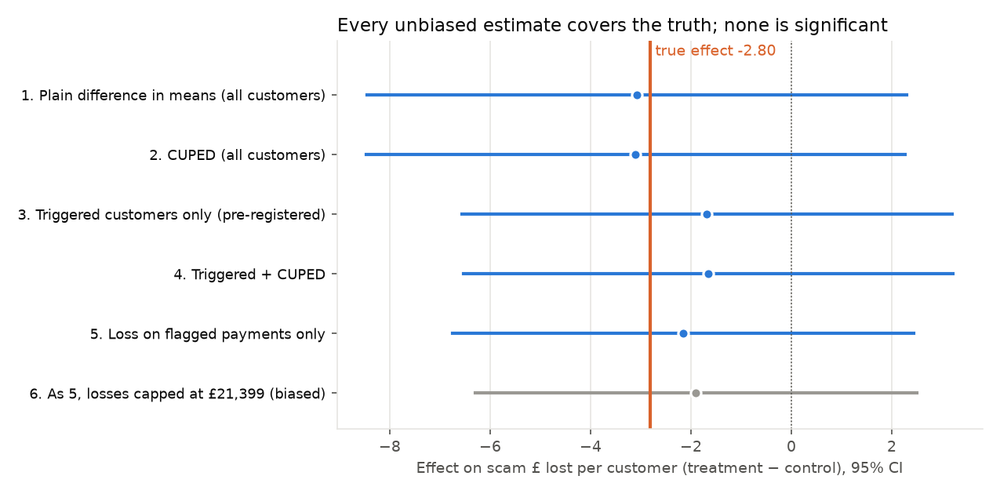

# Does a scam warning work, and who should see it?

[](https://github.com/datawitholoye/scam-warning-experiment/actions/workflows/ci.yml)

A bank is losing money to **authorised push payment (APP) scams**, where customers are tricked into sending money themselves. Product wants to show a scam warning before risky payments. But every warning also slows down genuine customers, and some give up on payments they meant to make.

This project answers the questions a product squad would actually ask:
1. **Does the warning reduce scam losses?** A properly designed A/B test.
2. **What does it cost?** Guardrails on genuine payments abandoned and support contacts.
3. **Who should see it?** Uplift modelling to target warnings where they change behaviour.
4. **What should we do?** A one-page decision memo for the PM.

## Why simulated data, and why that's a strength
Banks don't publish experiment data on scam warnings. So the data comes from a simulator in which **the true effect of the warning is set in advance** and hidden from the analysis. That makes it possible to check whether each method (plain A/B readout, CUPED, uplift models) actually *recovers the truth*, something you can never check on real data.

Every assumption lives in [`configs/simulation.yaml`](configs/simulation.yaml), and the design is explained in [`docs/simulation_design.md`](docs/simulation_design.md).

## Progress

| Day | Deliverable | Status |
|---|---|---|
| 1 | Simulator: customers, payments, scams, existing risk score, customer-level randomisation, hidden potential outcomes | ✅ |
| 2 | A/B test readout: trust checks, CUPED, triggering, guardrails, power, the cost of peeking, graded against the truth | ✅ |
| 3 | Uplift model: who should get the warning | ⏳ |
| 4 | Decision memo, final README | ⏳ |

## Day 2 findings ([full readout](reports/day2_ab_test.md))

- **The warning works, but the £ metric can't prove it in 4 weeks.** Scam £ lost fell by an estimated 9% (pre-registered estimator), not statistically significant. The true effect, revealed only after the analysis, is a 13% reduction (−£2.80 per customer), and every unbiased estimate's 95% CI contains it.
- **Why:** a few large scams dominate the £ total. With 50k customers per arm the test could only detect a 40% change in £ lost; detecting −15% would take about 28 weeks, or 19 if you count only losses on flagged payments.
- **Scams completed (a count) is significant: −15%, p = 0.02**, and matches the truth almost exactly. It is reported as a secondary metric and is not promoted to the headline after the fact.
- **Guardrails pass:** 3.1% of warned genuine payments abandoned (limit 5%), 2.0% support contacts per warning (limit 5%).
- **Peeking:** in 2,000 A/A replays, checking daily and stopping at p < 0.05 declared a false win **28%** of the time; weekly O'Brien-Fleming boundaries kept it at **5%**.



## Run it

```bash
python3 -m venv .venv && source .venv/bin/activate
make install
make simulate     # writes data/ and reports/simulation_summary.md (~15 s)
make analyse      # Day 2 readout -> reports/day2_ab_test.md (~10 s)
make test
```

## Project structure

```
configs/simulation.yaml     every assumption about the world
configs/analysis.yaml       pre-registered analysis plan: metrics, covariates, guardrail limits
src/scam_experiment/
  assign.py                 hash-based, customer-level randomisation
  simulate.py               customers -> payments -> scams -> risk score -> warning outcomes
  metrics.py                payment logs -> one row per customer (the unit of randomisation)
  stats.py                  difference in means, CUPED, delta-method ratios, SRM, power
  sequential.py             peeking simulation, O'Brien-Fleming boundaries
  analysis.py               Day 2 readout + grading against the hidden truth
docs/simulation_design.md   what is simulated, and why
reports/                    generated summaries
tests/                      simulation integrity + every statistical method checked on known cases
```
