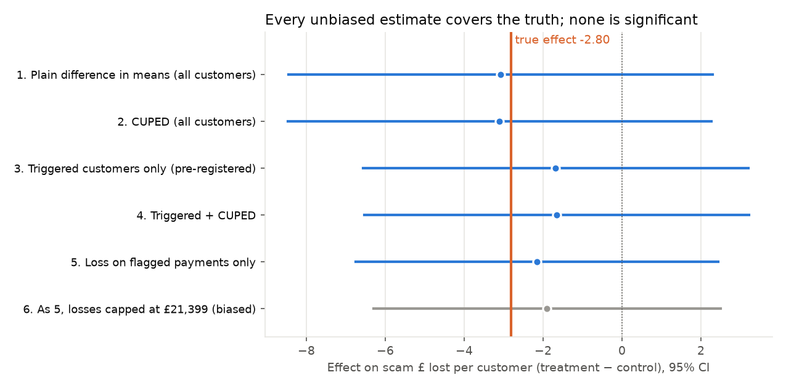
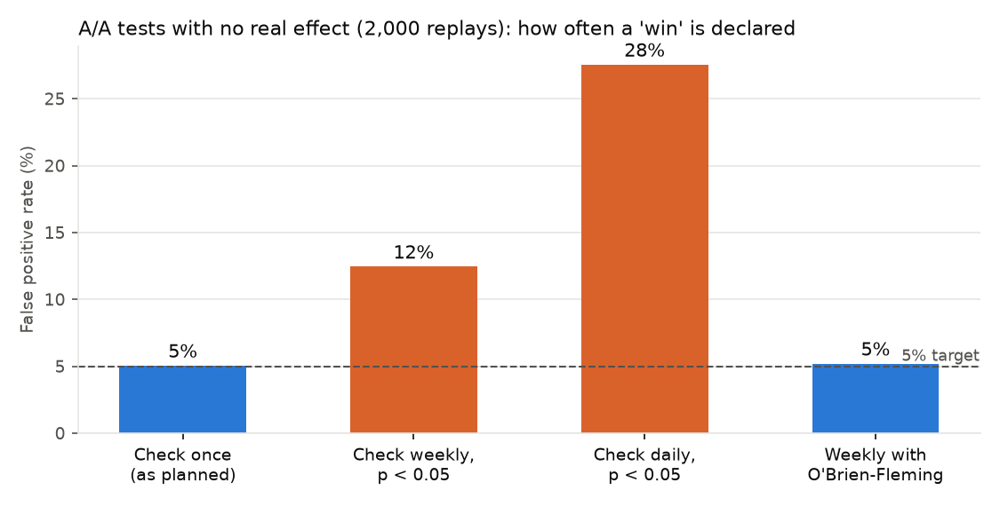
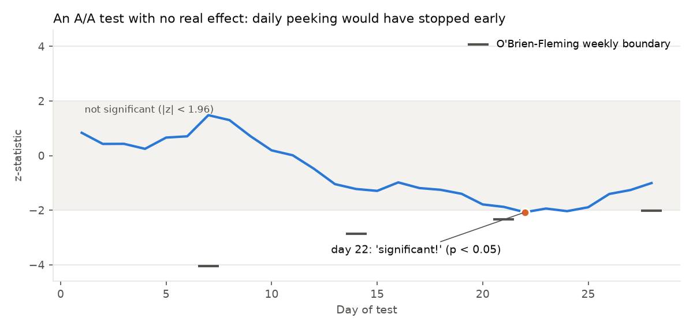

# Day 2: A/B test readout

## Headline

- **Primary metric (scam £ lost per customer): not statistically significant.** The pre-registered estimate is -£1.68 per customer (-9%), 95% CI -£6.57 to £3.20, p = 0.50.
- **Secondary metric (scams completed): significant.** -15% (p = 0.018). A count is far less noisy than £, because a few large losses dominate the £ total.
- **Guardrails: all pass.**
- **The test was underpowered for £ loss.** With 50,043 customers per arm it could only detect a 40% change in £ lost. A power analysis on historical data should have set the metric and duration before launch.
- **Grading:** the true effect (hidden until now) is -£2.80 per customer. Every unbiased estimator's 95% CI contains it.

## 1. Trust checks

- Split: 49,957 treatment / 50,043 control. Sample ratio mismatch test p = 0.79 (fine; < 0.001 would mean broken randomisation).
- Pre-period balance (p-values, all should be unremarkable): pre_payments 0.58, pre_new_payees 0.96, pre_spend 0.99, tenure_months 0.58
- Triggered (≥ 1 flagged payment): 46.5% of customers; by arm control 46.4%, treatment 46.6% (equal, as it must be for triggering to be valid).

## 2. Primary metric: scam £ lost per customer

All effects are per customer over the 4-week test (treatment − control). Negative = the warning reduced losses.

| Estimator | Effect | 95% CI | p | Variance removed vs plain | CI contains truth? |
|---|---|---|---|---|---|
| 1. Plain difference in means (all customers) | -£3.08 | -£8.44 to £2.29 | 0.26 | 0% | ✅ |
| 2. CUPED (all customers) | -£3.10 | -£8.46 to £2.26 | 0.26 | 0% | ✅ |
| 3. Triggered customers only (pre-registered) | -£1.68 | -£6.57 to £3.20 | 0.50 | 17% | ✅ |
| 4. Triggered + CUPED | -£1.66 | -£6.54 to £3.22 | 0.51 | 17% | ✅ |
| 5. Loss on flagged payments only | -£2.16 | -£6.75 to £2.43 | 0.36 | 27% | ✅ |
| 6. As 5, losses capped at £21,399 (biased) | -£1.90 | -£6.30 to £2.50 | 0.40 | 33% | ✅ |

True effect: **-£2.80 per customer**.

**What this shows:**
- **CUPED barely helps here.** Past payment behaviour doesn't predict who gets scammed, so there is little noise for it to remove. It shines when the outcome is predictable from history (e.g. spend).
- **Triggering helps most.** Only flagged payments can be warned, so losses elsewhere are pure noise. Restricting to flagged payments removes about a quarter of the variance.
- **Capping big losses cuts noise but biases the answer.** The capped estimate is shrunk towards zero; it can be used to *detect* an effect, not to *size* it in £.

## 3. Secondary metric: scams completed

Effect -0.00139 scams per customer (-15%), 95% CI -0.00253 to -0.00024, p = 0.018. True effect: -0.00138. Secondary metrics support the story but shouldn't be promoted to the headline after the fact: that is how false wins are manufactured.

## 4. Guardrails (limits set before the test)

| Guardrail | Estimate | One-sided 95% upper bound | Limit | Result |
|---|---|---|---|---|
| Genuine payments abandoned after a warning | 3.10% | 3.25% | 5% | ✅ pass |
| Support contacts per warning | 2.01% | 2.13% | 5% | ✅ pass |

Rates use the customer as the unit (delta method), because one customer's payments are correlated.

## 5. Power: how big should the test have been?

Using the control arm's spread (in practice: last month's data, before launch). Changes are relative to total scam £ lost (for both £ metrics) or total scams (for the count).

| Metric | Smallest detectable change now | Weeks needed for −10% | −15% | −20% |
|---|---|---|---|---|
| Scam £ lost, all customers | 40% | 64 | 28 | 16 |
| Scam £ lost on flagged payments | 33% | 43 | 19 | 11 |
| Scams completed (count) | 19% | 14 | 6 | 4 |

Weeks assume the same traffic (100k customers) and that both the effect and the noise grow in proportion to time.

## 6. Peeking: what if we'd checked every day?

2,000 A/A replays: the real customers re-randomised so there is **no** true difference.

| How results are checked | False positive rate |
|---|---|
| Once, at the end (as planned) | 5.1% |
| Every week, stop at p < 0.05 | 12.4% |
| Every day, stop at p < 0.05 | 27.6% |
| Every week with O'Brien-Fleming boundaries (z > 4.05, 2.86, 2.34, 2.02) | 5.2% |

Daily peeking turns a 5% error rate into about 28%; most false stops happen in the first week (median day 6), when few scams have been seen. If the business needs early looks, a sequential design allows them at almost no cost to the final threshold.

